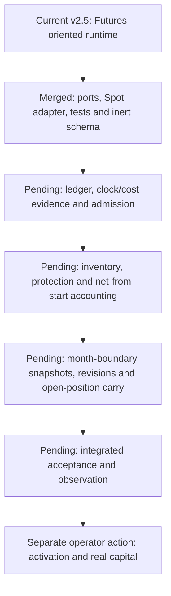

# Public Roadmap: v2.5 → v2.6 Spot-first

Status as of **2026-11-16**. This source carries `2.6.0-alpha.2`; [Releases](https://github.com/ldamasio/robson/releases) records published snapshots. Robson executes operator-authored trading decisions and manages their risk. **The v2.6 target is Binance Spot, LONG-only. The transition is in progress and is not ready for real capital.** A merged adapter or passing component test does not enable a complete Spot trading path.

[README](README.md) · [Release policy and status](docs/RELEASING.md) · [Venue decision: ADR-0056](docs/adr/ADR-0056-core-risk-vs-venue-adapters.md) · [Internal architecture plan](docs/architecture/v3-migration-plan.md)

## Direction and status

| Milestone | Public status | Evidence and limits |
| --- | --- | --- |
| Execution and risk foundation | Present in the repository | [Governed query engine](robsond/src/query_engine.rs), [risk policy](robson-domain/src/policy.rs) and [current venue factory](robsond/src/venue.rs). Current real venue selection remains USD-M Futures; simulation is separate. |
| Binance Spot adapter and component conformance | Merged components; activation pending | [Spot source and inertness boundary](robson-connectors/src/binance/spot/mod.rs), [Spot wire tests, PR #341](https://github.com/ldamasio/robson/pull/341), and [Futures preservation tests, PR #342](https://github.com/ldamasio/robson/pull/342). Loopback/fake-venue tests are not live Spot acceptance. |
| Durable Spot ledger foundations | Schema/index merged; remaining integration pending | [PR #343](https://github.com/ldamasio/robson/pull/343) adds inert schema and a one-attempt index. It does not introduce the production ledger writer or activate Spot. |
| Complete Spot execution and accounting | In progress | [ADR-0056](docs/adr/ADR-0056-core-risk-vs-venue-adapters.md) defines the required inventory, protection, settlement and acceptance work. The production factory still refuses `binance_spot`. |
| Net-from-start budget and month-boundary carry | Required minimum; integration pending | Account for governed net results and carry open positions through the month boundary using snapshots and revisions. This is part of the minimum before real capital, not post-activation work. See [ADR-0051](docs/adr/ADR-0051-net-from-start-monthly-budget.md) and [ADR-0056](docs/adr/ADR-0056-core-risk-vs-venue-adapters.md). |
| Real-capital Spot operation | Pending; operator-controlled | Requires the gates below and a separate activation decision. No release date or live-capital readiness is promised. |
| Distribution across additional exchanges | Future direction | Venue-neutral contracts make this possible; a second exchange, its market scope and its activation are not approved by this roadmap. Binance is first. |

## Next gates before activation

1. Integrate clock and cost evidence with admission, the durable ledger, inventory and execution paths, with review and required CI checks on the exact candidate. Preserve existing Futures protection and management of open or unsettled exposure during the transition.
2. Demonstrate typed fills, fees and reconciliation, net-from-start accounting and budget reservations, settlement completeness, and open-position carry through month-boundary snapshots and revisions. Unknown outcomes must remain visible and must not become invented execution or accounting evidence. The scan's legacy total-based capital recalibration writer is removed in this source; its guarded checksum alarms or skips an ambiguous book without authoring an adjustment. This scoped repair does not establish complete accounting acceptance. Validate basis changes atomically against current persisted state, enforce single-use transfer attribution, and distinguish funding recognition from its pending wallet-accounting integration; per-call checks alone do not establish these invariants. Complete exact trade/amount/asset linkage, durable absence/freshness evidence and status-error handling; retain startup Phase 2 transactionality as a separate unresolved requirement.
3. Validate Spot protection, replacement/cancellation, partial fills, residual inventory and restart recovery under the accepted venue constraints. Spot protection is not a claim that Futures `reduce-only` semantics exist on a balance account; the [ADR-0056 trade-offs](docs/adr/ADR-0056-core-risk-vs-venue-adapters.md) remain part of acceptance.
4. Complete integrated database/conformance tests and failure/recovery checks, then the documented observation, cutover and compatible rollback procedures. Component tests alone do not satisfy these gates.
5. Obtain the operator's explicit activation authorization for the selected account and release candidate. Documentation, merges and version labels do not authorize orders or capital allocation.

The initial acceptance sequence uses these public identifiers:

- **T1 — Authorized pilot:** execute the first pilot Spot operation under explicit operator authorization.
- **T2 — Fill and dust accounting:** check actual fills, the planned protected quantity, entry dust and its ledger row.
- **T3 — Protection evidence:** check the stop's own accepted record and confirm that locked inventory matches the governed quantity.
- **T4 — Operational checks:** confirm clear health indicators, venue eligibility, reconciled cash and no settlement hold.
- **T5 — Governed close:** close through `DELETE /positions/{id}` and the exit transition; verify liquidation, accounting against the cash change, and cancellation of the protective stop.
- **T6 — Reserved expansion:** raise the operating cap only after independent review of T1–T5 and a completed snapshot of the first month boundary after T1, with the reserved operator decision.

T6 is not a prerequisite for the first operation and is not authorized by this roadmap. The month-boundary wait starts at the authorized T1 pilot; technical release publication is separate from these operational checks.

## Risk and control commitments

The transition preserves the **1% per-trade worst-case cap** and **4% monthly budget** against `capital_base`, budget-metered entry capacity, and technical stops derived from chart analysis rather than a percentage of entry price. Execution costs and venue constraints must be priced into the reviewed risk envelope. See [ADR-0021](docs/adr/ADR-0021-opportunity-detection-vs-technical-stop-analysis.md), [ADR-0039](docs/adr/ADR-0039-exchange-side-insurance-stop.md), [ADR-0043](docs/adr/ADR-0043-budget-metered-entry-admission.md) and [ADR-0051](docs/adr/ADR-0051-net-from-start-monthly-budget.md).

Protection and exits remain safety-critical. Reconciliation requires typed order/trade evidence; an unexplained residual is an open accounting problem, not an automatic adjustment. Robson does not use an LLM to choose trades, originate signals or override risk controls. These are existing constraints, not new policies introduced by the roadmap.

## Reading versions and progress

**v2.5** describes the existing product line; **v2.6** names the planned Spot-first product release. Files named `v3-*` and identifiers such as `MIG-v3#N` are historical internal architecture vocabulary and remain unchanged. They are not a second release announcement.

This roadmap records direction and repository evidence, not a shipping schedule. The first development snapshot, [v2.6.0-alpha.1](https://github.com/ldamasio/robson/releases/tag/v2.6.0-alpha.1), was published on 2026-11-15 from commit `ccac64c39dfaa2c4c88e4a46d4925f3e469674bd`, with aligned Cargo/local lock/frontend versions and CI-built container images. It publishes the roadmap and release identity; the remaining operational gates above still apply. Transition work advances through alpha, beta and rc snapshots toward `2.6.0`; `2.5.x` is compatible maintenance only. The [release policy](docs/RELEASING.md) explains strict source/tag identity and the historical release correction, with original notes archived. Publication follows existing review and CI gates; operational activation remains separate.
