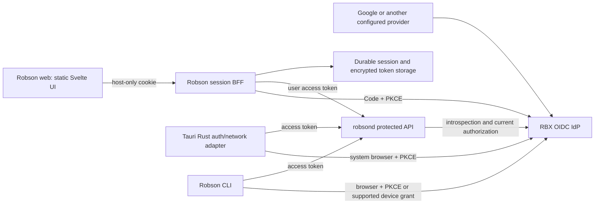

# ADR-0055: Product sessions across web, native clients, and CLI

Date: 2026-10-20

Status: DECIDED for local implementation; FOLLOW-UP REQUIRED for production
acceptance, persistent storage and native clients. No deployment authorized.

Scope: Robson, with reusable RBX contracts. This is a product adoption proposal,
not unilateral ratification of a new organization-wide standard. The existing
single-operator boundary and all trading invariants remain mandatory.

Operator acceptance: on 2026-10-20, the operator explicitly accepted these
guidelines after reviewing the local implementation and its limitations. This
confirms the direction for Robson within the authorized local-only scope.
Production acceptance, deployment, organization-wide standard ratification,
persistent storage, real-IdP validation and native-client acceptance remain
separate follow-ups.

Implementation planning: the
[durable-product-sessions OpenSpec change](../../openspec/changes/durable-product-sessions/proposal.md)
tracks persistence, distributed credential transitions and real-IdP acceptance.
Its [task checklist](../../openspec/changes/durable-product-sessions/tasks.md)
is pending implementation; completed planning artifacts do not satisfy the
production gates below.

## Publication boundary

This planning/tracking branch publishes the accepted architecture and pending
OpenSpec plan. The local prototype described below lives in the separate
`feat/robson-product-sessions-local-20261020` worktree at `a0e50c91`/`d9ec2b08`;
its runtime changes are not included in this branch or established as merged
main behavior. References to local implementation and tests below describe that
prototype. Deployments and provider acceptance remain pending.

## Problem and current implementation

The operator reports that a dashboard can remain visibly signed in after time
has passed, then return to login after a reload. Repository evidence explains
how this is possible; it does not establish the cause of a particular outage.

Verified against Robson `145e1c1cf0e9a52085607098168df001342e5ecf` (also remote
main when checked), Identity `e715d9a73824c49a83a03c7eab110ff944b7ae07`, and
Governance `3ae72efce0a200528b23dc5c875bf0946cc93a4c`:

- [C1] `frontend/src/lib/stores/auth.ts`: a Google ID token in `sessionStorage`
  is sufficient to mark the UI authenticated. The store does not expire that
  state by clock. GIS renewal starts within 600 seconds of expiry and has a
  five-second timeout. The GIS library loads only on the login page.
- [C2] `frontend/src/routes/(authed)/+layout.svelte`: a three-minute interval
  tries renewal; failure does not invalidate the displayed authenticated state.
- [C3] `frontend/src/lib/api/robson.ts`: a first HTTP 401 triggers renewal;
  inability to renew clears auth. A renewed credential followed by another 401
  is an API error, without consistent terminal-session handling. The event
  stream has a separate renewal path and a 45-second read-idle watchdog.
- [C4] `robsond/src/auth.rs` and `api.rs`: Google ID-token verification on
  protected requests, one allowlisted email, no product session. `/status`,
  position reads, and halt status are public. `/events` is checked at connect;
  its open stream does not periodically revalidate auth. Heartbeats prove
  transport activity, not fresh business data or a currently valid credential.
- [C5] `robson-cli/src/auth.rs`: the CLI already differs from web. It uses
  Google's device grant and caches an ID token, refresh token, and expiry in a
  user-only file, renewing before use. It does not depend on GIS One Tap.
- [C6] No `src-tauri`, `tauri.conf.json`, `tauri.conf.json5`, or `Tauri.toml`
  was found in this Robson checkout. Native behavior below is a target, not
  evidence that mobile or desktop clients already exist.
- [C7] Identity `crates/rbx-session` implements idle/absolute expiry and
  in-memory/Redis storage. Its reference BFF implements Code+PKCE, nonce,
  cookies, CSRF logout, and `/me`; defaults are 30 minutes idle / 480 absolute.
  `TokenResponse.refresh_token` is parsed but not retained for user renewal.
  This is not a complete user-token proxy or a complete native session system.
  `/me` touches activity, and `BrowserSession::renew` can extend `expires_at`;
  neither is automatically suitable for the policy proposed below.
- [C8] Governance ADR-0013 requires federation through the RBX IdP, canonical
  RBX identities, and separation of authentication and entitlement. ADR-0016
  requires a product-owned BFF; Identity supplies shared contracts/libraries.

The public frontend's auth bundle was also inspected on 2026-10-20 and matches
C1-C3. Production backend configuration and incident logs were not available
from this workstation. No user tokens or private account data were inspected.

## External references and limits

The references below establish documented behavior, not the vendors' private
backend architecture. Their exact cookies, rotation algorithms, device binding,
and unreported TTLs are not assumed.

| Product/reference | Documented fact | Lesson for RBX |
|---|---|---|
| [Claude web][S1] | A 28-day inactivity session; activity can refresh its deadline hourly. | Product session lifetime differs from an upstream identity token. |
| [Claude session controls][S2] | Enterprise admins can impose absolute limits even during active use. | Idle and absolute limits are separate policies. |
| [Claude device sessions][S3] | Users can inspect and terminate individual device/browser sessions. | Sessions need revocation and understandable device labels. |
| [Claude Code authentication][S4] | Desktop uses OAuth; CLI credential storage differs by OS; expired, nonrenewable logins require login again. | Same identity can have different client adapters and explicit expiry UX. |
| [ChatGPT/Codex authentication][S5] | Web retains a browser session; desktop/CLI open a browser for sign-in. Codex caches credentials and refreshes tokens during use; CLI storage can be keyring, file, auto, or ephemeral. | Persist the appropriate client credential and renew without repeating human login. No universal ChatGPT session TTL was established from this source. |
| [Google GIS][S6] | Sign-in ID tokens last one hour; Google explicitly separates this from application session management. | Do not use the Google ID-token expiry as the product login lifetime. |
| [RFC 8252][S7], [RFC 9700][S8] | External browser for native authorization, PKCE, current OAuth protections, refresh-token replay defenses. | A Tauri WebView is not the place to embed the Google login page. |
| [Tauri deep links][S9] | Cold-start and running-app callbacks differ; desktop platforms have additional instance-routing requirements. | Native callbacks require platform-specific acceptance tests. |
| [ZITADEL introspection][S10], [revocation][S11] | An API can introspect opaque or JWT access tokens; signature-only JWT validation cannot establish early revocation. | State an explicit revocation bound and test it. |
| [ZITADEL token lifetimes][S12] | Documented default token-lifetime settings apply instance-wide. | Do not alter every RBX product just to tune Robson. |

## Proposed decision

Use one canonical identity system and authorization vocabulary, with distinct
web and installed-client session adapters. Google remains a sign-in option
federated through the RBX IdP; Robson authorizes an explicitly onboarded
`(issuer, subject)`, never an arbitrary Google email or every authenticated user.
Do not automatically merge/link accounts by equal email during migration.

### Ownership and topology

- Add a distinct `robson-session-bff` service inside this monorepo, using
  public OIDC libraries and the RBX identity contracts. Robson is public, while
  the inspected Identity crates are proprietary and unpublished; do not copy
  them or add a private Git dependency to a public build. The local BFF uses
  the certified `openid-client` library; the execution runtime remains Rust. Keep the Svelte bundle
  static. Route `/auth/*` and `/api/*` on each frontend origin to the BFF.
  Static hosting and a same-origin BFF can coexist; adapter-node is not required.
- Each web origin gets its own host-only cookie and exact redirect URI. Prefer
  separate client registrations per web origin; use separate registrations for
  desktop, Android, iOS, and CLI. No shared browser cookie across products or
  registrable domains. SSO comes from the external browser's IdP session.
- Reuse UI components, API schemas, auth-state vocabulary, and domain logic.
  Do not reuse browser token storage in Tauri. A native build chooses its
  adapter at build/bootstrap time, not via a spoofable user-agent string.
- `rbx-infra` owns routing, TLS, registrations/secrets delivery and deployment.
  No DNS, IdP registration, global token-policy change, or deployment occurs
  merely by accepting this document or merging product code.

### Web adapter

- OIDC Authorization Code + PKCE S256; random single-use `state` and `nonce`,
  exact configured redirects, callback bound to the initiating browser through
  a short-lived HttpOnly, SameSite=Lax transaction cookie (Strict breaks the
  cross-site authorization callback). Store pending transactions in a
  shared store with TTL and atomic consumption; an in-process map is not HA.
- After verification, create an opaque random session; browser receives
  `__Host-robson_session`, `Secure`, `HttpOnly`, `SameSite=Lax`, `Path=/`,
  without `Domain`. Persist a hash/HMAC of its identifier server-side.
- The BFF keeps upstream refresh/access tokens encrypted at rest. Encryption
  key delivery and rotation belong to infrastructure; never hardcode a key.
  No access/refresh token in JS, localStorage, sessionStorage, URL, or logs.
- Reverse proxy only explicit Robson routes to one configured backend.
  Strip inbound Authorization and identity headers; forward the validated
  user's access token. Do not use a shared service credential to impersonate
  the operator. `robsond` independently enforces issuer, audience, access-token
  semantics, scopes and the approved canonical operator.
- Require exact Origin and a session-bound CSRF token on unsafe methods,
  including logout and activity updates. Fetch Metadata is defense in depth.
  `/auth/session` returns status, nonsecret expiry metadata, permissions and a
  CSRF token, never credentials or session identifiers. Cache-Control: no-store.
- Serialize upstream refresh per session across replicas using a distributed
  lease and versioned compare-and-set. Update the rotated token atomically.
  Never automatically retry a refresh whose outcome is unknown; keep the
  session paused and require reauthentication if recovery cannot prove state.

### Native adapters: desktop and mobile Tauri

- Public OAuth clients: no embedded client secret. Launch the system browser
  or platform authentication session; Authorization Code + PKCE S256, state,
  nonce and exact callbacks. The Google login itself stays outside the WebView.
- Desktop: loopback listener bound only to a loopback IP on an ephemeral port,
  or a registered app link supported by the IdP/OS; one-shot callback with
  timeout and state validation. No wildcard non-loopback listener.
- Android/iOS: verified App Links/Universal Links where supported, with actual
  app/domain association. A custom scheme is a fallback only with PKCE and
  tested interception handling. Do not assume desktop loopback works on mobile.
- Rust owns tokens and authenticated networking. JS invokes typed operations
  and gets nonsecret session state. Restrict Tauri capabilities and IPC commands;
  no generic arbitrary-URL authenticated fetch or token-export command.
- Store refresh credentials in Keychain/Keystore-backed storage on mobile and
  the OS credential store on desktop. Android Keystore protects the encryption
  key; it is not a generic plaintext token database. Select and validate actual
  platform adapters before release. No silent plaintext fallback for Tauri.
- On app resume, unlock and network restoration: check session, renew if
  necessary, reconnect streams, resync snapshots, then enable actions. Do not
  rely on a background JS timer; mobile suspension is normal.
- Biometrics can unlock local secure storage. They do not alone establish
  server-verifiable recent authentication or new trading authorization.

### CLI adapter

Use RBX issuer Code+PKCE through the system browser on interactive desktops.
Use the IdP's supported RFC 8628 device grant for remote/headless human login,
after checking support and client registration. The existing Google device flow remains the shipped CLI path until this
replacement is verified; it is not silently removed by a web migration. Prefer OS keyring; an explicit headless file mode may
use owner-only permissions, symlink checks, atomic writes and a process lock.
Automation gets separate scoped service identities, not copied human refresh
tokens. Native/CLI grants are separate installations, not one copied credential.

### Session and reauthentication policy (candidate values)

These are RBX proposal values, not vendor defaults or a currently active policy.
The product must honor the stricter upstream limit. A product may impose a
shorter deadline; it cannot silently extend the IdP's permitted lifetime.

| Layer | Candidate policy |
|---|---|
| Short-lived API access | Aim for 5-10 minutes if supported without an instance-wide change; otherwise rely on bounded introspection plus product policy and record actual TTL. |
| Remembered personal-device login | 7 days inactivity, 30 days absolute from authentication. Explicit opt-in on web; secure-storage prerequisite on native. |
| Nonremembered/shared-device login | 30 minutes inactivity, 12 hours absolute; session cookie has no persistent Max-Age. |
| Trading action freshness | 15 minutes since verified interactive authentication for risk-increasing actions. Activity and refresh never extend this proof. |
| Reauthentication warning | Show an actionable warning before a hard deadline; distinguish expiry from network trouble. |

Define activity as user-initiated foreground navigation/action, reported through
a bounded CSRF-protected endpoint at most once per minute. Polls, heartbeats,
token refresh, background jobs and `/auth/session` do not extend user inactivity
or absolute deadlines. The server owns timestamps; reported activity is a UX
signal, not proof of user presence. The absolute deadline never slides on token
refresh; only fresh interactive authentication can start a new session lineage.

A recent-authentication lock blocks new risk and account/security changes. With a valid,
authorized base session it must not add a fresh-login requirement to protective
close/disarm/panic actions. Such actions still require current authorization
and existing engine gates. An expired/revoked base session grants no anonymous
emergency privilege. Daemon risk controls and exchange-side stops continue
independently of every UI session and of IdP/BFF availability.

Step-up uses Code+PKCE, `prompt=login`, `max_age=0`, nonce/state and a
transaction bound to the current session. Verify the same canonical subject
and `auth_time` no earlier than the transaction start minus five seconds of
clock skew (nor later than server time plus five seconds). Silent SSO with old
`auth_time` cannot unlock trading. Rotate the opaque session identifier; keep
its original absolute and idle deadlines. A new explicit login starts a new
lineage; step-up does not. Resource-server enforcement also requires trusted
`auth_time`; missing provider support fails closed rather than trusting a BFF
header. The exact real-IdP claim contract remains an acceptance gate.

**Availability decision (Fable P0-1):** this local implementation deliberately
fails closed on introspection failure for *all* API writes, including protective
manual close/disarm/panic. The recent-auth lock alone does not restrict those
protective actions, but an IdP outage can. No degraded JWT bypass is added.
Automatic daemon risk handling and exchange-side insurance stops remain
independent. This dependency is accepted for the local sandbox, not silently
accepted as the final production availability policy. Measure the outage and
revocation trade-off before rollout; retain the local-Google-session alternative
if the dependency cannot meet Robson's operational needs.

`POST /reconcile-close` intentionally remains sensitive: its handler applies
operator-supplied historical fill evidence to book/accounting state, potentially
changing available risk budget. It is not the emergency order-closing endpoint.
Only single-position DELETE, panic and halt are classified as protective.

### Recorded upstream values: mandatory before real activation

| Contract | Local fixture evidence | Actual RBX IdP |
|---|---|---|
| Access lifetime | Configurable; default 3,600 s | Not verified |
| Refresh idle / absolute | Rotation fixture only; not a 30-day endurance proof | Not verified |
| Audience, scopes, issuer, canonical subject | Positive and negative verifier tests | Mapping/registration pending |
| Fresh auth_time after prompt=login/max_age=0 | Silent-SSO rejection test | Federation behavior pending |
| Per-grant revocation / rotation reuse | Local fixture and race tests, including cleanup after lost races | Sandbox acceptance pending, including step-up grant isolation |
| Device authorization / installation identifier | Not implemented in fixture | Not verified |

The 7/30-day web values are product upper bounds, not a promise that the real
IdP will authorize that duration. Honor stricter upstream expiry. Do not change
instance-wide token lifetimes as a side effect of Robson implementation.

Native idle/absolute enforcement needs a server-visible per-installation grant
identifier and deadline. An expiry timestamp held only in a mobile app is not
enforcement. Verify the IdP's grant identity, per-grant revocation and refresh
rotation/reuse handling in a sandbox. If those guarantees cannot be established,
native persistent login is blocked pending a separately reviewed integration;
do not invent a proprietary OAuth/token issuer in Robson to fill the gap.

### Authorization, revocation and transport contracts

- Start with the existing single operator mapped explicitly to canonical RBX
  identity. A login does not grant trading. Current authorization is checked
  for every mutation; future commercial entitlement remains a separate gate.
  Do not cache a role snapshot for a 30-day session.
- Private balances, positions, event history and control endpoints become
  authenticated. Only minimal liveness/readiness remains public; metrics gets
  a separate internal/observability boundary. Inventory consumers before cutover.
- Native requests and BFF-forwarded user access tokens use IdP introspection
  plus resource/audience/scope checks. Cache positive read verdicts for at most
  30 seconds and no later than token expiry; mutations bypass that cache.
  Timeouts are unavailable/503, not invalid-login/401; never fail open on writes.
  The local slice uses **no positive read cache**, including SSE. On recheck,
  unavailable authority closes a stream as well as rejected authority; the UI
  shows offline and reconnect uses bounded backoff. Keeping it until access
  expiry could exceed the intended revocation bound. Production may introduce
  a measured bounded read cache; it must not silently turn into TTL-long grace.
- Local web logout deletes the session atomically before reporting success and
  attempts upstream revocation; failed upstream cleanup is recorded/retried.
  Native logout revokes the grant before erasing it when online. Offline local
  erasure cannot claim remote revocation. A separate trusted device must be able
  to revoke a lost installation once that management feature is implemented.
- “This device”, “all Robson devices” and “all RBX products” are different
  operations. Global logout requires IdP revocation/back-channel integration
  and enumeration of product sessions. A cookie deletion is not global logout.
- Target at most 60 seconds from confirmed server revocation to termination of
  existing protected streams; mutation admission checks current authority.
  SSE rechecks session and token status every 30 seconds and at token deadline.
  Missing/revoked state closes it. Do not claim this SLA until provider revocation
  and product-session propagation tests prove it, including multiple replicas.
- BFF SSE proxy disables buffering, preserves heartbeats and cancellation,
  bounds connections and reconnection backoff, and performs snapshot resync on
  reconnect. Keep SSE; adding a BFF does not require WebSockets or gRPC.
- UI state: `checking`, `authenticated`, `refreshing`, `offline`,
  `reauth_required`, `signed_out`. Data freshness is separate. Last successful
  snapshot time, transport health, auth state and pending actions are explicit.
  Cached data is labeled stale and cannot authorize a mutation. A terminal 401
  after the one allowed renewal transitions to reauthentication immediately.
- Never automatically replay trading mutations after timeout, disconnection,
  login or refresh. Preserve a draft, not a pending execution. Query outcome by
  operation ID when possible; an unknown result requires reconciliation and a
  new deliberate operator action. Authentication checks precede engine dispatch.

## Alternatives and trade-offs

| Option | Advantage | Defect/cost | Proposed disposition |
|---|---|---|---|
| Keep Google ID token everywhere | Smallest patch, current verifier | Hourly GIS dependency, no product session/revocation, poor native fit | Interim UX repair only |
| Exchange Google token into a local session | Earlier relief from hourly expiry | Retains direct Google trust and a parallel identity mapping; Google ID tokens lack reliable recent-auth proof | Legitimate lower-dependency fallback if RBX capability gates fail |
| RBX IdP + product BFF + native OAuth | Aligns identity, client storage and revocation boundaries | New runtime, durable storage, refresh coordination and IdP dependency | Leading candidate |
| One central BFF for all RBX products | Fewer runtimes | Couples cookies/releases and violates ADR-0016 | Reject |
| Cookie login embedded in every Tauri WebView | Reuses web UI flow | Embedded-login restrictions, isolated cookie jars, native lifecycle gaps | Reject |

The selected direction changes the constraints of ADR-0025/ADR-0054 and the
no-proxy decision of ADR-0047. Accepting it must explicitly supersede those
choices for authenticated clients; the streaming/proxy regression risk in
ADR-0047 remains a release criterion. It costs a small product service and
session store; do not claim zero new infrastructure or existing readiness.

## Failure modes, performance and observability

| Dependency/failure | Prevention and detection | Recovery/allowed behavior |
|---|---|---|
| IdP unavailable | Bounded timeouts, shared JWKS/cache, introspection/refresh metrics | Cached read verdict only to its deadline; writes fail closed; retain local credential; explicit offline/unavailable UI; engine continues. |
| Session store unavailable/lost | Durable store, tested recovery, encrypted backup where applicable | No new authenticated actions on uncertain session state; invalidate affected sessions after loss; never fall back to in-memory production sessions. |
| BFF restart/deploy | Shared pending login/session state; readiness and bounded SSE draining | Browser cookie survives restart if server state survives; reconnect/resync; no assumption FE restart is harmless to proxy streams. |
| Token rotation race | Distributed lease + version CAS, process lock on CLI | One exchange; revoke/logout must win over late refresh. Unknown outcome does not trigger blind replay. |
| Mobile suspend/clock change | Resume-driven authoritative check, server time | Mark stale, refresh/reconnect, snapshot, then allow actions. |
| Auth valid but data feed stale | Separate last-snapshot/stream age and health | Preserve labeled last data, disable risk-increasing actions until resync. |
| Browser XSS/CSRF or native malicious IPC | HttpOnly, CSP, exact Origin/CSRF; scoped Tauri commands | Revoke affected sessions, audit without recording tokens; HttpOnly does not make XSS harmless. |
| Revocation/store race | Atomic invalidation/tombstone, versioned writes | A late refresh cannot resurrect a revoked session. |

Budget: login has bounded discovery/JWKS (cached), code exchange, validation and
session creation. The local web proxy has one session lookup,
one BFF introspection and one API call (whose resource server independently
introspects): two introspections total, plus at most one coordinated refresh.
A session-status poll has one introspection plus a possible refresh. A mutation
has the same bounded request budget; any entitlement call is explicit and
cached only for a bounded read policy. No per-widget token exchanges. Deduplicate
concurrent `/status` loads and refreshes. Monitor request counts, 401 by safe
reason, 503, refresh latency/failure, stream age, revocation delay and active
sessions; cap cache sizes and expire entries. Never emit raw cookies, tokens,
authorization headers, PKCE verifier, identity-provider callback query or PII.

## Robson adoption sequence and acceptance

1. **Architecture/review**: reconcile this ADR with Fable 5.1; explicitly decide
   policy values and upstream/native capability gaps. Record human acceptance
   separately from model review. The existing runtime is still ADR-0054.
2. **Current-web correctness slice**: correct expired UI state, renewal loading,
   terminal 401 handling and stale/offline feedback. Preserve the current token
   contract until BFF cutover; this slice does not make a long-lived session.
   Move private reads behind the current verifier in this slice as well.
3. **Web session BFF**: add the distinct service and tests, shared store, Code+
   PKCE, encrypted token storage/rotation, same-origin proxy, logout and
   nonsecret session-status endpoint. Use the shared identity contract and public OIDC primitives; do not copy
   proprietary Identity source into this public repository.
4. **API migration**: add explicit RBX access-token verification, canonical
   operator admission and protected read routes. Provision sandbox clients and
   mappings through infrastructure. Use mutually exclusive verifier modes. The local implementation rejects
   configurations combining RBX and Google/legacy; there is no dual-accept
   fallback or new migration bypass. A future dual window needs separate review.
5. **CLI and native**: migrate CLI, then implement Tauri desktop and mobile
   adapters when their actual apps and platform registrations exist. Test each
   OS callback/key-store/resume flow; sharing Svelte does not prove parity.
6. **Operational rollout**: reviewed `rbx-infra` change, staged traffic, positive
   and negative login tests, session revocation and SSE soak beyond token expiry.
   Remove direct Google and legacy bearer acceptance after acceptance evidence.

Required tests: forged/expired/wrong-audience/ID-instead-of-access tokens; callback
state/nonce/replay/mix-up and redirect tampering; CSRF; concurrent cross-replica
refresh/logout and rotation-crash cases with property-based interleavings;
absolute/idle deadlines unaffected by polling; active use across multiple access
token expirations; offline resume; no plaintext/native-token IPC; revocation of
an open SSE; proxy buffering/restart; failed introspection never admitted; no
automatic mutation replay; protective exits/daemon stops independent of UI login.

Rollback: first invalidate/tombstone product sessions and revoke their upstream
grants, retaining cleanup evidence; do not orphan an encrypted token vault.
Then, before disabling legacy auth, roll back the new clients/BFF together
to the known current release, documenting that product revocation guarantees
do not apply on that path. After credentials/legacy routes have been revoked,
do not silently reopen them: forward-fix or perform a separately authorized
rollback with new credentials and an explicit temporary risk decision. Keep
monitoring and daemon/exchange protection running through every cutover.

## Repository implementation and remaining gates

The local implementation is executable and tested, not a production migration.
`robson-session-bff` deliberately refuses non-loopback endpoints and any mode
other than `local`; robsond's RBX verifier also refuses a nonlocal issuer and
production mode. No production config, infrastructure or IdP settings changed.

- Implemented: public-library Code+PKCE/nonce, bound one-use callbacks, explicit
  canonical operator, opaque HttpOnly SameSite cookies, encrypted in-memory
  token vault, bounded stores, single-flight refresh, no ambiguous replay,
  logout winning races, session/CSRF/activity endpoints, step-up ID rotation,
  protected proxy with streaming cancellation, and mock-OIDC integration tests.
- Implemented: opt-in frontend session adapter (`PUBLIC_ROBSON_AUTH_MODE=session`),
  browser resume checks, explicit offline/expiry states, step-up/logout UI,
  legacy clock expiry, terminal 401 handling and no automatic mutation replay.
- Implemented: isolated resource-server introspection adapter, audience/scope/
  identity/recent-auth checks, private read protection and SSE revalidation.
- Pending production: shared durable store with CAS/tombstones and distributed
  refresh leases; crash recovery; persistent failed-revocation queue; production
  Secure `__Host-` cookies/TLS and secret rotation; provider acceptance matrix;
  multiple-replica/restart/long-lived SSE soak, latency and memory profiling.
  Local cookies intentionally use a different name without Secure on loopback
  HTTP and cannot be promoted merely by changing an environment flag.
- Pending apps: Tauri does not yet exist in this repository. Native adapters,
  actual secure storage and callbacks need platform projects/registrations.
  Shipped CLI remains Google-based; RBX CLI migration needs real grant support.

The current stream has no durable Last-Event-ID replay. The initial migration
explicitly accepts expiration-driven reconnect plus existing snapshot resync;
it does not claim seamless stream continuity. Measure reconnects, snapshot
cost and stale intervals before overriding ADR-0047 operationally.

Local sessions disappear on BFF restart, including pending revocation cleanup.
This restriction is enforced and is a production blocker. The in-memory vault
validates crypto and rotation behavior; it is not evidence of durable storage.
See `robson-session-bff/README.md` for reproducible local-only execution.

### Consumer inventory for private read protection

Repository inventory on 2026-10-20: all Svelte status/position/halt calls use
`apiFetch` (Bearer in Google mode, BFF cookie in session mode). The local BFF
forwards its validated user's bearer. The shipped Rust CLI API client exposes
reconciliation/acknowledgement mutations, already with Bearer; it is not an
unauthenticated status reader. Kubernetes probe paths remain public. Local
smoke documentation (`docs/SMOKE-TEST.md`, `docs/PROMPT-PACK.md`) assumes auth-
disabled development. Production/testnet runbooks VAL-001/VAL-002 contained
unauthenticated curl examples and are marked for authenticated reads now.
No new unauthenticated read is admitted merely because it is a probe. External
scripts/monitors outside this repository are not inventoried and require an
operational inventory before rollout. This is a deliberate compatibility change
in Google mode too, with no production deployment performed here.

## Review record

The operator explicitly requested Fable 5.1. Availability was confirmed using
Claude Code 2.1.292; actual result metadata identified `claude-fable-5-1`,
provider `firstParty`. The first frozen-pack review returned **approve-with-changes**.
P0-1 is resolved explicitly above for local scope; P0-2 specifies fresh-auth
proof/rotation; P0-3 requires actual upstream values before activation.
P1 changes cover callback SameSite, mutually exclusive auth modes, private
reads, polling activity, rollback token cleanup and honest native/CLI status.
A second frozen-pack architecture/code review also returned
**approve-with-changes**; its findings and source-checked dispositions are in
[the review record](../reviews/2026-10-20-auth-session-review.md). The final
correction record is not represented as a third clean approval by Fable. Its output is evidence, not a deployment/acceptance grant.
Governance ADR-0026 is still Proposed; this single requested review is not
represented as a completed two-reviewer institutional gate.

[S1]: https://support.claude.com/en/articles/10310342-how-do-i-log-out-of-all-active-sessions
[S2]: https://support.claude.com/en/articles/13163631-configuring-session-security-settings
[S3]: https://support.claude.com/en/articles/13124001-managing-your-active-sessions
[S4]: https://code.claude.com/docs/en/authentication
[S5]: https://learn.chatgpt.com/docs/auth
[S6]: https://developers.google.com/identity/gsi/web/reference/js-reference#credential
[S7]: https://www.rfc-editor.org/rfc/rfc8252
[S8]: https://www.rfc-editor.org/rfc/rfc9700
[S9]: https://v2.tauri.app/reference/javascript/deep-link/
[S10]: https://zitadel.com/docs/guides/integrate/token-introspection
[S11]: https://help.zitadel.com/how-to-revoke-an-access-token/refresh-token
[S12]: https://help.zitadel.com/configure-oidc-token-lifetimes-in-zitadel
