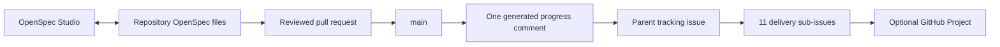

# OpenSpec and GitHub tracking

Status: implemented repository tooling; automatic publication starts only after
this workflow and its mapping are merged into `main`. The initial issue report
may reference the published planning branch. Authentication implementation and
deployment remain pending.

## Ownership and workflow

Pilot: [parent #244](https://github.com/ldamasio/robson/issues/244), delivery
issues #245–#255, and [progress report](https://github.com/ldamasio/robson/issues/244#issuecomment-6306049749).

OpenSpec files are the authority for technical scope, requirements, scenarios,
and checklist completion. OpenSpec Studio reads those files from a local Git
checkout. GitHub Issues own assignment, priority, discussion, blockers, and PR
links. A GitHub Project can display those same issues; it is an optional view.



The durable-session plan has one parent issue and one sub-issue per
`AUTH-DUR-*` work package. Its 28 detailed tasks remain in `tasks.md`; do not
create a second editable checklist in Issues. Each delivery issue links its
source section. Update implementation checkboxes in the same reviewed PR that
provides the corresponding code/tests/evidence. Close a delivery issue only when
its acceptance is evidenced; an infrastructure blocker is not completion.

The publisher refreshes **one dedicated comment on the parent issue**, including
per-package counts and immutable source links. It never creates/closes issues,
changes their bodies, assignments, labels or comments, changes Project status,
or writes back into OpenSpec. Apart from that single mapped report, discussion
is exclusively human/agent authored. A checksum detects manual edits to the
generated report and stops publication instead of overwriting those edits.

Issue closure, card movement, a complete planning document, and an implementation
checkbox are distinct signals. No GitHub action authorizes deployment or starts
Studio Specflow. CI reports only merged progress; local/unmerged work remains
visible through its PR and the local Studio.

## Decision and trade-offs

| Option | Benefit | Cost / decision |
| --- | --- | --- |
| Links only | Minimal maintenance | Progress can become stale; retained for delivery issue descriptions |
| Repository projection into one report | Versioned, reviewable, bounded and independent of desktop availability | Chosen; delivery metadata stays in GitHub and only merged checklist progress is automatic |
| Studio fork with GitHub synchronization | Could provide a unified desktop experience | Deferred: adds OAuth credentials, synchronization races and desktop distribution work before the Robson workflow is proven |
| Bidirectional checklist synchronization | Edit either surface | Deferred: introduces conflicting completion authorities and requires conflict/acceptance semantics |

The implementation is deliberately a Robson pilot. A future Studio contribution
can consume a generalized mapping/report contract after this workflow is proven.
Do not copy Robson's hard-coded pilot identity into an upstream feature. Any
future upstream contribution is separate work; no contact with the author is
implied by this installation.

## Operation

`openspec/github-tracking.json` records exact existing issue/comment identifiers.
It contains no credentials. The script uses Python's standard library; it adds
no runtime or package dependency to Robson.
Bandit security tooling is separately pinned, including wheel hashes for the
Ubuntu x86_64/Python 3.12 CI environment, and scanned by the existing OSV job.

```sh
python3 -B -m unittest discover -s scripts/tests -v
python3 -B scripts/openspec_github.py --source-sha "$(git rev-parse HEAD)"
```

Preview does not access GitHub. `--publish` requires the serialized default-branch
GitHub Actions job, a matching repository/ref/event/SHA, and a token with
`contents:read` and `issues:write`. PR validation has no issue-write permission;
forks and `pull_request_target` cannot publish. The action is pinned by full SHA.
The optional Project is not required and the workflow needs no Projects token.

The HTTP budget is **two reads and at most one write**: current main ref, mapped
comment, and an optional PATCH of that comment. An unchanged report uses two
reads and no write. Requests have 20-second timeouts, redirects are refused,
responses and input files are capped at 1 MiB, and work is bounded at 64 packages
and 1,000 tasks. Each invocation exits; there are no watchers, queues or caches.
Requests/counts/source SHA appear in the job result, without token values.

Workflow publication is serialized, with older in-flight publication allowed to
finish before the next run. A stale main SHA is rejected before writing. A newer
commit may land after the head check; the report remains explicitly anchored to
its source SHA until the next queued run. Do not configure another publisher
against the same comment. Manual local preview cannot publish.

## Failure and recovery

| Failure | Behavior | Recovery / visible evidence |
| --- | --- | --- |
| GitHub outage, rate limit or missing permission | Fail job; preserve existing report and local files; no blind retries | Fix availability/permission and rerun the workflow on current main |
| Response lost after PATCH | Outcome may be uncertain; never append another comment | Rerun reads the same mapped comment; identical content is a no-op |
| Missing/edited/wrong-issue report | Refuse to overwrite | Inspect and explicitly restore the dedicated report or review a new mapping |
| Renamed task, duplicate ID, unknown checkbox syntax or mapping mismatch | Fail preview/CI; never silently omit tasks | Update the parser/mapping in a reviewed PR |
| Job crash or interruption | At most one comment update; source files untouched | Rerun current main; no data migration or queue recovery |
| Project unavailable | Issue discussion and progress projection continue | Restore the optional view when its permissions are available |
| Studio/workstation unavailable | Merged plans remain accessible on GitHub | Open another checkout; GitHub is not dependent on the local Studio server |

To disable synchronization, disable the OpenSpec tracking workflow or remove its
publish job through review. Keep issues, report, mapping and specifications as
audit evidence. A reverted commit's checklist is projected on the next run;
closed issues are never silently reopened. GitHub retains edit history for the
report and source commits retain the checklist history.
