# Design: Durable product-session implementation

## Context

Status: implementation plan; FOLLOW-UP REQUIRED. No runtime change or deployment
is performed by this planning change. ADR-0055 remains the governing decision.

Source baseline at `d9ec2b08`, reviewed on 2026-10-20:

| Current source | Repository-verified behavior | Planned change |
|---|---|---|
| `robson-session-bff/src/sessions.mjs:19` | `Map` store, object-identity checks, process-local refresh promise | Async transactional contract; persisted versions and attempt identity |
| `robson-session-bff/src/sessions.mjs:25` | AES-GCM token envelope, one runtime key, no associated-data binding | Versioned envelopes bound to session lineage, credential generation and issuer/subject |
| `robson-session-bff/src/sessions.mjs:36` | Expiry deletes rows from memory | Durable terminal transition plus cleanup job |
| `robson-session-bff/src/server.mjs:39` | Pending OIDC transactions in another `Map` | Shared encrypted one-use transaction store |
| `robson-session-bff/src/server.mjs:57` | Revocation attempted inline; failure counter only | Transactional cleanup outbox and bounded retry worker |
| `robson-session-bff/src/server.mjs:156` | Last pre-dispatch check uses object identity | Last awaited version/status/deadline check; define in-flight request boundary |
| `robson-session-bff/src/server.mjs:173` | SSE revalidation every 30 seconds | Shared-store check and existing IdP checks with the same revocation budget |
| `robson-session-bff/src/main.mjs:14`, `src/oidc.mjs:9`, `robsond/src/rbx_auth.rs` | Loopback-only configuration, local insecure HTTP OIDC | Preserve local mode; distinct constrained TLS sandbox profile for real-provider acceptance |
| `frontend/src/lib/stores/productSession.ts` | Offline/401 distinction, generation guards, bounded activity | Add durable-logout failure/recovery scenarios without claiming global logout on failure |
| `scripts/test-pg.sh:78`, `robsond/tests/` | Guarded PostgreSQL runner and Rust integration tests | Rust-owned isolated database lifecycle launches the Node acceptance processes |

## Goals / Non-Goals

Goals: remembered login survives ordinary BFF restart; concurrent processes never
resurrect revoked sessions or reuse an uncertain refresh generation; expired
sessions cannot be extended by polling; recovery has durable, redacted evidence.

Non-goals: uninterrupted login after every crash, exactly-once external OAuth
effects, weakening fail-closed behavior, automatic trading-request retries,
production HA certification, implementing Tauri or changing trading invariants.

## Decisions

### Storage and ownership

| Option | Benefits | Costs / omitted guarantees | Decision |
|---|---|---|---|
| In-memory store | Fast, already tested | Loses state; no cross-process authority | Keep only as a deterministic test adapter |
| SQLite/local file | Restart persistence with small setup | Node-local failure domain; no shared multi-instance authority | Reject for the target |
| Redis with scripts and persistence | Fast atomic transitions; aligns with an RBX Identity reference | Durability/failover policy and outbox recovery still need design; additional authoritative store | Defer |
| PostgreSQL with short transactions | Sessions, generation checks and cleanup intent commit together; existing repository migration/test conventions | Adds latency and DB availability dependency; requires pool/query discipline | Selected for implementation, pending measured acceptance |

Use a dedicated `robson_auth` schema in an infrastructure-provisioned database;
the BFF runtime role has access only to auth objects, not trading tables or DDL.
Root `migrations/` remains the only migration source. Infrastructure owns role
creation/grants and execution of migrations in shared environments. Start with
the existing supported PostgreSQL service/version; no database upgrade is implied.
An isolated database may be chosen by infrastructure without changing the store
contract. Do not reuse exchange-credential encryption keys.

Keep the Node BFF and public OIDC library. A PostgreSQL driver is selected and
version-pinned in the implementation task after maintenance/license/vulnerability
checks; this plan adds no runtime dependency. Rewriting the BFF in Rust merely
to share a private Identity crate would expand scope and violate the public
repository boundary.

```mermaid
flowchart LR
    Browser[Browser: opaque HttpOnly cookie] --> A[BFF instance A]
    Browser --> B[BFF instance B]
    A --> DB[(PostgreSQL auth schema)]
    B --> DB
    Worker[Bounded cleanup and recovery worker] --> DB
    A --> IdP[RBX IdP: federated Google login]
    B --> IdP
    Worker --> IdP
    A --> API[robsond: independent authorization]
    B --> API
    API --> IdP
    Engine[Daemon risk controls] --> Exchange[Exchange protective stops]
```

### Persisted records and secret handling

- Sessions: hashed random cookie ID, random lineage ID, canonical subject,
  issuer/client identity, policy, original creation/absolute deadline,
  last foreground activity, trusted `auth_time`, state, monotonic row version,
  credential generation, envelope key ID, encrypted credentials and attempt ID.
  Session rotation replaces the cookie/CSRF binding atomically, preserving
  lineage and deadlines. No raw cookie ID is persisted.
  Authority version changes with state/cookie/credential transitions, not with
  foreground activity; activity has its own monotonic timestamp/update version.
  Refresh commits re-evaluate deadlines against the current activity timestamp.
- OIDC transactions: hashed state and browser binding, encrypted verifier/nonce
  and protocol context, five-minute expiry, parent lineage/version for step-up,
  one-use status and exchange attempt. No authorization code is logged or kept
  after exchange. Callback URLs and headers are redacted before access logging.
- Cleanup outbox: unique lineage/generation/attempt/token-role/fingerprint intent with encrypted token
  pair, key ID, retry count, next-attempt time, attempt lease, result category and
  bounded redacted evidence. Provider-issued grant identifiers are used only
  after verifying their semantics; never infer grant independence from tokens.
  Distinct old and late-returned token pairs can coexist, while identical
  retries deduplicate. A separate tokenless unknown-grant job retains uncertain
  outcomes and routes unresolved containment to remediation, never to success.
- Audit: bounded retention of state transitions and attempt outcomes with
  correlation IDs; no tokens, cookies, authorization codes, emails or raw subject
  values in operational logs/metrics. Internal subject data is access-controlled.
- A separate session epoch supplied by infrastructure prevents restoring an old
  database backup from restoring accepted cookies. Restored state is quarantined
  until the epoch is advanced outside that backup and upstream grants are
  reconciled. Ordinary process restart preserves the current epoch.

Restore recovery first fences all BFFs and workers from auth traffic, including
old processes that may resume later. Every admission checks the shared epoch
against the externally supplied epoch; workers carry that fence too. Restore is
not complete until stale instances are rejected and the external epoch is
reconciled with the new database control record. A cached process epoch alone is
insufficient. Test a stale BFF/worker rejoining after recovery.

This fence must be enforced by infrastructure's restore path, before any restore
can replace data, not by an optional operator step afterwards. Restore privileges
are restricted to that path. A restored auth namespace stays quarantined and
all prior-epoch Robson-client grants are invalidated, including grants missing
from the backup, using proven provider bulk/client-scoped containment or waiting
out the verified maximum grant lifetime. Never revoke unrelated RBX products.
If this restore/fencing contract cannot be enforced, restore acceptance fails.
A periodic external high-water mark may detect some rollback, but cannot prove
safety for a logout after the last checkpoint; it is not the chosen guarantee.
The plan does not claim to detect arbitrary privileged out-of-band DB tampering.

Use AES-256-GCM with random IVs and authenticated context including envelope
format, lineage, subject/issuer binding and credential generation. Do not bind
to frequently changing activity timestamps. Store ciphertext/key IDs in the DB;
inject a versioned key ring externally. New writes use the active key, bounded
rewrap jobs migrate old envelopes, and an old key is retired only after no live
session, transaction, cleanup job or required recovery backup depends on it.
Missing/corrupt key material fails closed and emits an actionable category.
Emergency key compromise invalidates the affected epoch/grants; it is not an
ordinary rewrap. Evidence must cover both paths before real activation.

Local model and sqlx harnesses inject an ephemeral two-key fixture (`test-v1`,
`test-v2`) with reproducible seeded test inputs where needed. Fixture key IDs are
rejected by the real-provider profile and never reused as deployed keys. No
infrastructure key ring is required for envelope/model tests.

### Transitions and refresh crash boundary

All state transitions use the DB clock, row version, expected generation and
deadline predicates in short transactions. The database clock must be monitored
for drift. Never hold a transaction or row lock across an HTTP request.
Process-local promises may coalesce calls, but never authorize a transition.

1. Claim an active session's refresh generation in a committed transaction,
   assigning one attempt ID and a fencing value. Other callers wait for bounded
   time or receive a retryable read-unavailable result; they do not refresh.
   The initial lease is ten seconds, longer than the two-second protocol bound
   plus DB acquisition/commit bounds. Waiters make at most two additional reads,
   after 100 ms and 250 ms plus bounded jitter, then return unavailable without
   dispatching a mutation. There is no unbounded DB polling.
2. The owner sends that generation to the IdP at most once, under the existing
   two-second protocol timeout. The attempt is considered externally uncertain
   from claim onward: a crash before sending may still require login again.
3. Commit the resulting encrypted tokens only if the attempt/authority-version/epoch is
   still current, the session is live, and both deadlines remain valid. Refresh
   and step-up never move the original absolute deadline.
   Concurrent foreground activity does not invalidate a refresh fence; state,
   cookie or generation changes do. Recovery of expired attempts is worker-only:
   readers deny expired leases without making a hidden recovery write.
4. Logout, expiry, rotation or a lost fence wins. Late returned credentials must
   be recorded for cleanup, not installed or returned to the browser/backend.
5. Lease expiry is **not permission to reuse the old refresh token**. Recovery
   marks the attempt uncertain, pauses the session and requests interactive
   authentication. A late owner cannot commit once the fence changes.

No transaction can atomically include an IdP call. A crash after the IdP rotates
but before the response is durably stored can leave an unknown new credential.
The session remains denied; grant-family revocation or proven bounded upstream
expiry must contain this case. Record it as unresolved cleanup, never as success.
Real-provider acceptance must prove the containment/revocation semantics. A
provider incapable of meeting the requirement blocks activation.

An authorization code exchange has the same uncertainty rule: atomically consume
the browser-bound transaction before exchange, persist the attempt, never reuse
the code after timeout/crash, and require a fresh login. Parallel callbacks can
produce at most one successful session transition. Step-up also checks current
cookie, lineage, subject and parent version after the external await.

### Logout, expiry, rotation and dispatch

Commit terminal state and cleanup intent in one transaction before acknowledging
global logout. Clearing a browser cookie is not proof of server invalidation.
If the datastore cannot commit, clear the session cookie and replace it with a
signed, HttpOnly, purpose-bound logout-intent cookie containing only its session
hash, epoch and ten-minute expiry. Issue it only for the same-origin validated
logout request; it grants no read, login, refresh or trading authority. Return
503 with `global_logout_confirmed: false` and keep the UI in logout-pending state.
Every BFF processes a valid intent before login or authenticated work and retries
the idempotent terminal commit when the DB recovers. The intent cookie survives
reload until successful invalidation or its fixed expiry; it is never renewed
silently. If it expires or is lost before confirmation, clearly require a fresh
login and product-session revocation through the operator recovery procedure;
never claim global logout. Test signing-key rotation and invalid/expired/replayed
intents as well as DB recovery. Other BFFs deny authenticated work while shared
authority is unavailable. A valid intent cannot revoke a different session/epoch.
Use a key-ring-signed CSRF proof bound to the session hash, epoch and origin in
session metadata so a logout request can be validated without a DB read. An
invalid/missing proof cannot mint an intent; retain a locked, unconfirmed retry
state in that case. The browser cannot choose another session hash in a body.
The non-authorizing intent uses a separate signing purpose from the CSRF proof.

Terminal IDs are never reused. Keep tombstones until all attempts/leases capable
of referring to the generation have ended and cleanup has terminal evidence.
Retention is bounded by an explicitly configured upstream maximum lifetime;
unknown lifetime blocks garbage collection of unresolved credentials and blocks
activation. Admission limits/backpressure and alerting bound backlog growth;
never silently drop cleanup jobs to meet a size cap.

Reserve cleanup capacity durably **before** every external code exchange or
refresh that might issue a credential. Existing live grants retain an owned
cleanup slot; invalidate by changing that slot's state rather than inserting
into an already-full queue. New issuance requires an available reservation;
uncertain attempts retain theirs until a proven terminal disposition. Tests
must fill capacity before concurrent logout/expiry and still prove atomic
invalidation plus retained cleanup. Successful refresh generations within the
same grant are not independently revoked while that grant is active.

Successful ordinary login may start a new lineage. Step-up rotates cookie and
CSRF values while preserving both session deadlines. Persist old-grant cleanup
only after verifying that provider revocation cannot invalidate the new grant.

Before dispatch, re-read the shared session/version/deadlines. A write already
dispatched before revocation can finish: authentication cannot roll it back.
No claim of instantaneous cancellation or exactly-once trading is made. The
daemon continues to verify access tokens and enforce its existing action gates.
Never automatically replay a mutation after an auth/network failure.

SSE checks shared session authority and IdP at most 30 seconds apart; combined
check timeouts remain within the 60-second revocation target under healthy
scheduling. A DB/IdP failure closes the stream and shows offline/stale state.
Heartbeats, read-idle watchdogs and reconnect snapshot resync remain mandatory.
New long-lived read caches or grace periods require a separate availability
decision. All manual writes still fail closed during IdP outage, including
protective actions; engine/exchange protection remains independent.

### Cleanup, recovery and resource budgets

Cleanup workers claim small batches with expiring fenced leases. Retry revocation
only when provider acceptance establishes safe idempotent/grant semantics, using
exponential backoff and jitter. Persistent permanent failures become visible
dead-letter records requiring remediation. Lost or ambiguous outcomes do not
erase the job. Recovery emits durable attempt/epoch transitions before readiness.

Separate evidence states: local invalidation, revocation requested, known access
token inactive, and grant contained. A successful revoke response alone does not
prove family containment. Budget a post-revoke introspection for each known
access token; inactive access alone also cannot prove refresh-family revocation.
Terminal family evidence requires the provider's verified grant-revocation
contract/status or the verified maximum grant lifetime elapsed. Probe refresh
denial only on disposable acceptance grants, never on production cleanup jobs.
Tokenless uncertain jobs remain unresolved until equivalent containment evidence.

Coalesce duplicate expiry triggers for the same lineage without discarding
distinct credentials/attempts. Use fair weighted scheduling (four urgent
logout/uncertain jobs to one expiry job), a 30-second retry-backoff ceiling and
metrics for oldest age and measured drain rate. Initial limits: 1,000 active
sessions, 200 pending logins, 4,000 cleanup/reservation slots. Admission reserves
all possible token/unknown-outcome slots before issuance. Test admission resuming
within 60 seconds of dependency recovery when at least one eligible job can
reach verified terminal state under the two-second protocol bounds. If all jobs
need manual containment, admission stays denied and alerts; no false recovery
SLA is claimed. Resize only from measured drain/admission evidence.

Initial measurement budgets (targets, not benchmark results):

| Operation | DB statements / external requests budget |
|---|---|
| Session status without refresh | <=3 DB; <=5 if waiting on another owner; one IdP introspection |
| Activity | <=2 DB; zero IdP; update no more than once/minute/session |
| Proxy without refresh | <=4 DB; <=6 with bounded waiting; one BFF introspection + one backend request; count daemon introspection separately |
| Refresh owner | <=12 DB for the full request including claims/commit; one refresh + one introspection; cleanup asynchronous |
| Logout/expiry | <=5 DB including terminal+outbox transaction; no synchronous external dependency to acknowledge committed logout |
| Callback/step-up | <=12 DB; one code exchange; bounded discovery/JWKS misses counted separately |
| Cleanup worker batch | <=100 records; concurrency <=4; <=2 revokes + 1 access introspection per token pair; each protocol request <=2 seconds; provider-specific grant verification counted separately |

Count transaction commands and retries; instrument observed counts per operation.
The guardrail's 15-per-operation threshold still triggers review. Each BFF has
five request connections and a separate two-connection SSE pool. The standalone
cleanup/recovery worker has its own two-connection pool; it never borrows the
request pool. Initial bounds are 250 ms acquisition, one second per statement
and three seconds for a complete short DB transaction. The ten-second refresh
lease exceeds the protocol plus acquisition/commit bound with margin.
Default SSE cap is eight per BFF, with two concurrent checks, each bounded to
five seconds: four waves consume at most 20 of the 30-second revalidation window,
leaving scheduling margin. Stagger checks, deny excess connections visibly, and
measure queue/statement overhead against this bound. Two BFFs plus one worker
therefore require a budget of 16 DB connections. SSE work is counted per
connection/check interval, not hidden inside a never-ending request counter.
Bound login attempts, sessions, waiters, jobs and connection count; instrument
queue age/depth, pool waits, cleanup failures and refresh uncertainty. Profile
memory/task/listener growth in sustained and reconnect workloads.

## Risks / Trade-offs

| Failure / dependency | Behavior and recovery | Visible evidence |
|---|---|---|
| PostgreSQL unavailable / pool exhausted | Deny authenticated work with 503; no memory fallback; bound wait; close streams; retry safe reads with backoff | Store-unavailable metric, UI offline, pool wait/timeout, readiness failure |
| BFF dies / owner freezes | Healthy committed sessions survive restart; incomplete attempts become uncertain; no refresh replay; another process resumes cleanup | Durable recovery transitions and attempt counters |
| DB backup restore / lost writes | Quarantine auth; advance external epoch and reconcile grants before opening; accept logout of all affected users | Recovery epoch and operator-visible reconciliation evidence |
| Key service / key material missing | Deny decrypt/auth, retain encrypted evidence; recover key or invalidate affected grants | Key-ID error category; never key/ciphertext logs |
| IdP / Google federation outage | No login/refresh/authorized writes; existing streams close when revalidation fails; queue cleanup; daemon stops independent | Identity unavailable and oldest cleanup age; UI offline |
| Provider rotates then response lost | Deny session and require new interactive login; contain old grant by verified family revoke/lifetime bound | Uncertain refresh and unresolved-grant evidence |
| Backend API unavailable | Bounded 502/503 or stream closure, stale UI; never replay writes | Upstream timeout and snapshot age |
| Exchange/feed unavailable | Existing daemon and exchange-stop policy handles it; auth work grants no trading fallback | Existing risk/feed alerts; auth evidence cannot certify exchange health |
| Observability sink unavailable | Persist minimal bounded recovery/outbox evidence locally in DB, alert on lag; metrics failure cannot grant auth | Export lag/readiness policy; unresolved audit backlog |
| Cross-instance time skew | DB owns session deadlines; skew beyond protocol tolerance denies recent auth; correct time before retry | Clock offset and fresh-auth rejection metrics |
| Cleanup backlog reaches limit | Retain pending cleanup, limit new sessions/replacements; allow safe local invalidation; remediation restores capacity | Queue-depth/age alerts; capacity-denied category |

Availability is intentionally traded for security at uncertain boundaries.
Routine restart should preserve login; a crash inside credential rotation may
require login again. PostgreSQL adds latency and an operational dependency.
Keeping revocation cleanup durable increases encrypted-secret retention, so
retention and key retirement are explicit acceptance conditions.

## Migration Plan

Implementation order and evidence are in [tasks.md](tasks.md). First establish
the async contract/model, then schema and store, refresh/callback atomicity,
cleanup, failure UX and integration acceptance. Each code slice includes tests.
All real DB tests use the guarded `scripts/test-pg.sh` entry point and an ignored
Rust `#[sqlx::test(migrations = "../migrations")]` harness in `robsond/tests/`;
that harness launches Node against its isolated DB and cleans child processes.
It cannot provision a server/role or run against production. A fixture-only
test pass is never reported as PostgreSQL or real-IdP acceptance.

PostgreSQL roles are cluster-wide. Statically verify the migration and the
least-privilege grant contract; behaviorally test privileges only with an
infrastructure-provisioned restricted role supplied as `ROBSON_TEST_RUNTIME_ROLE`.
The isolated harness may apply the infrastructure-owned schema grant fixture
and `SET LOCAL ROLE` after validating/quoting the role name; it never creates a
role or alters global role attributes. Without that input the privilege check
is explicitly pending, not inferred from tests running as the database owner.

Model/envelope/worker/UI work in AUTH-DUR-04 through AUTH-DUR-08 can proceed
against the async test adapter after AUTH-DUR-01. Their separate live-acceptance
tasks depend on AUTH-DUR-03 and infrastructure; the dependency graph must not
serialize pure model work behind unavailable external resources.

Real IdP tests need a separate explicit sandbox profile: exact HTTPS issuer,
origin/backend allowlists, redirect registration, normal certificate validation,
no insecure OIDC transport, dedicated credentials and operator test identity.
Production mode remains rejected. The existing loopback fixture remains intact.
Sandbox enablement requires infrastructure-provided inputs; do not guess URLs,
read production secrets or change instance-wide provider token lifetimes.

Before future rollout, require all acceptance evidence, Fable 5.1 review,
resolution of availability/cleanup gaps and separate operational authorization.
Rollout must invalidate prior sessions and clean grants deliberately; rollback
cannot reopen revoked IDs or silently restore direct-Google acceptance. Leave
schema additive until retention/cleanup is proven complete; do not drop the
encrypted vault or cleanup backlog as a rollback shortcut.

## Integration inputs still required

These gate execution/acceptance, not the selected contract: infrastructure-issued
isolated DB access and least-privilege role; externally managed epoch/key ring;
sandbox issuer/client/redirect/subject/audience/scopes; actual refresh and grant
revocation semantics; measured maximum upstream lifetimes. Unsupported semantics
require a revised ADR, not a hidden relaxation. No live values were inspected
or changed while preparing this plan.

## References

- [OpenSpec workflow](https://github.com/Fission-AI/OpenSpec/blob/main/docs/concepts.md)
- [PostgreSQL locking](https://www.postgresql.org/docs/current/explicit-locking.html)
- [OAuth security BCP, RFC 9700](https://www.rfc-editor.org/rfc/rfc9700)
- [Revocation response semantics, RFC 7009](https://www.rfc-editor.org/rfc/rfc7009.html#section-2.2)
- [PostgreSQL cluster-wide roles](https://www.postgresql.org/docs/current/database-roles.html)
- [ADR-0055](../../../docs/adr/ADR-0055-product-sessions-web-native-cli.md)
